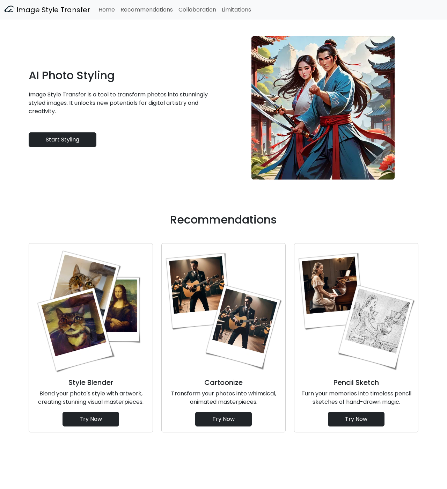
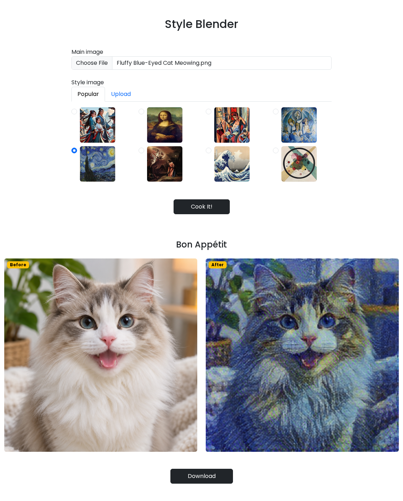
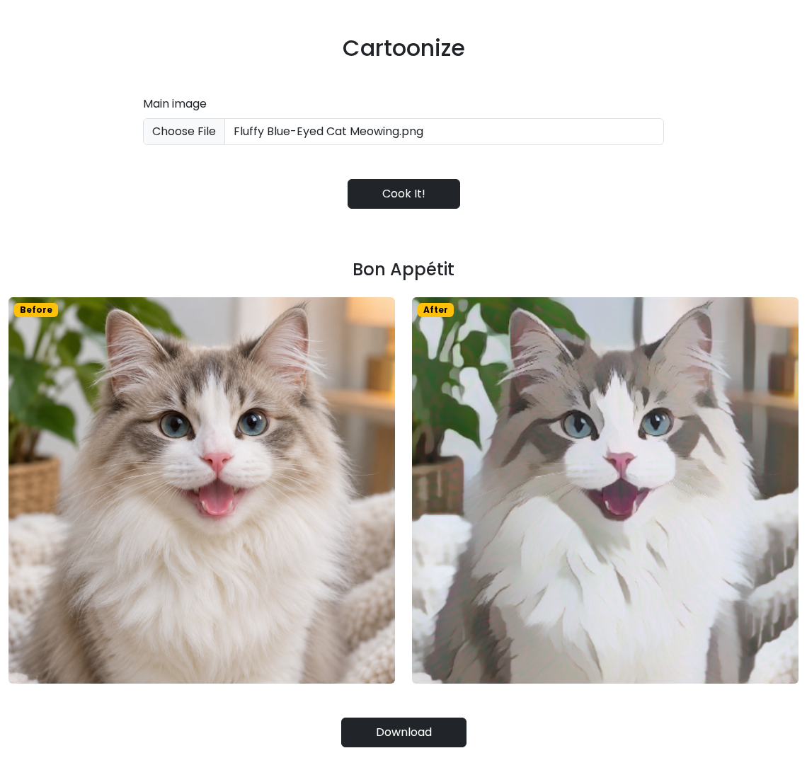
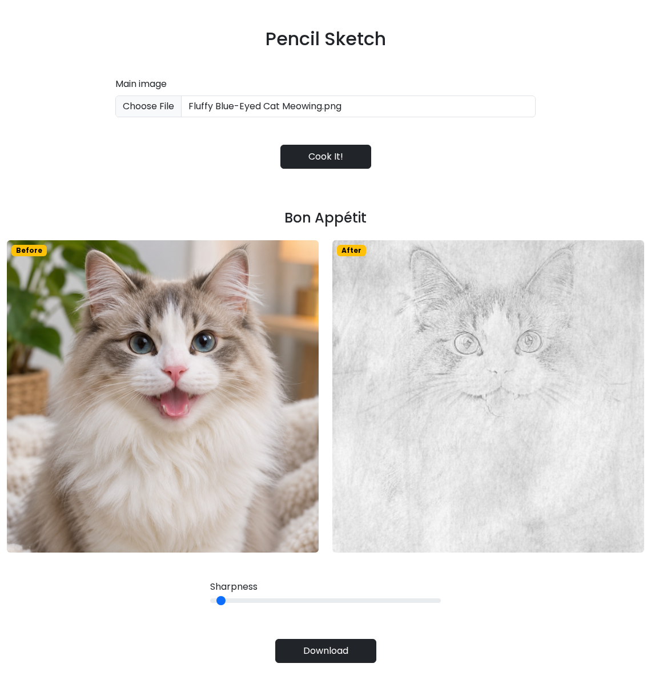
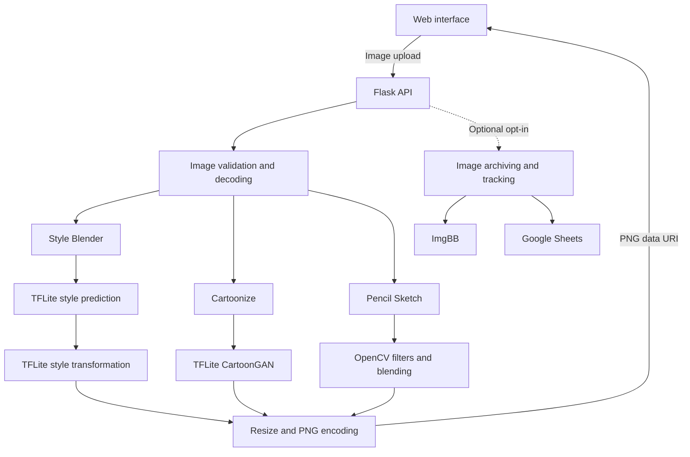

# Image Style Transfer

An image stylization application for neural style transfer, cartoonization, and pencil sketch generation, powered by TensorFlow Lite and OpenCV.

Originally developed in 2024 as StyleDreamer, the application combines pretrained neural networks with classical computer vision techniques in a Flask web interface.

## Preview



## Features

- **Style Blender:** Apply the artistic style of a custom reference image or a built-in template using a two-stage neural style transfer model.
- **Cartoonize:** Transform photographs using a pretrained CartoonGAN model.
- **Pencil Sketch:** Generate textured pencil sketches with adjustable sharpening using OpenCV.
- **Local processing:** All inference runs on the application server without cloud inference services.
- **Optional image archiving and analytics:** ImgBB image storage, Google Sheets metadata, sketch sharpness updates, and download tracking. Disabled by default and subject to user opt-in.
- **PNG download:** Preview the original and processed images and save the result directly from the browser.

## Example results

All three screenshots were captured from the running Flask application using the same AI-generated cat image. The processed previews are actual outputs of the bundled TensorFlow Lite models and OpenCV pipeline.

### Style Blender



Style reference: **Starry Night (Van Gogh)**. Both the style prediction and style transformation models run locally.

### Cartoonize



Generated with the bundled CartoonGAN TensorFlow Lite model.

### Pencil Sketch



Generated with OpenCV at sharpness 5. No neural model is used for this mode.

## Architecture



Style transfer uses a 256 × 256 style input and a 350 × 350 content input. Cartoonization uses a 512 × 512 input. The application integrates existing pretrained models rather than training them from scratch.

## Getting started

Target environment: 64-bit Python 3.11. Internet access is required to install dependencies and load the interface's CDN resources. All three processing modes have been verified locally with TensorFlow CPU 2.19.1, OpenCV 4.11.0.86, NumPy 1.26.4 and Python 3.12. The complete pinned Python 3.11 environment has not been verified.

| Mode | Capabilities | Configuration |
| --- | --- | --- |
| Local processing (default) | All three image transformations, style templates, previews, sharpness adjustment and PNG downloads | No credentials required |
| Analytics-enabled | All local features plus ImgBB image archiving, Google Sheets metadata, sharpness updates and download tracking | [Analytics setup](docs/analytics.md), with user opt-in |

### Windows (PowerShell)

```powershell
py -3.11 -m venv .venv
.\.venv\Scripts\python.exe -m pip install -r requirements.txt
.\.venv\Scripts\python.exe app.py
```

### Linux

```bash
python3.11 -m venv .venv
.venv/bin/python -m pip install -r requirements.txt
.venv/bin/python app.py
```

Open [http://127.0.0.1:5000](http://127.0.0.1:5000). To customize settings, copy `.env.example` to `.env` in the repository root. The application loads `.env` automatically; existing environment variables take precedence. No credentials are needed unless analytics is enabled. The Flask development server is intended for local use.

## Usage

Choose a feature, upload the required JPEG or PNG images, select **Cook It!**, and download the result. Style Blender supports bundled and custom style images; Pencil Sketch supports adjustable sharpness. If analytics is configured, the user can opt in to image archiving and activity tracking before processing.

| Guide | Contents |
| --- | --- |
| [User guide](docs/usage.md) | Each feature, available templates, input limits, preview and download behavior |
| [Configuration](docs/configuration.md) | Environment variables, dependency setup and credential locations |
| [Analytics setup](docs/analytics.md) | ImgBB, service account, spreadsheet headers, tracking behavior and troubleshooting |
| [API reference](docs/api.md) | Request fields, responses, endpoints and code-level content blending |
| [Verification](docs/verification.md) | Automated tests, example generation and manual integration checks |

## Project structure

```text
image-style-transfer/
├── app.py              # Flask routes
├── config.py           # Application settings
├── models/             # Pretrained models and style references
├── modules/            # Image processing pipelines
├── utilities/          # Validation and shared helpers
├── templates/          # Jinja templates
├── static/             # Styles, scripts and assets
├── tests/              # Unit and integration tests
├── scripts/            # Inference verification
├── docs/               # Usage and verification details
├── .env.example       # Configuration template
├── requirements-analytics.txt
└── requirements.txt
```

## Testing

With the virtual environment activated:

```bash
python -m pip check
python -m unittest discover -s tests -v
python scripts/verify_release.py --repeat 5
```

The verification script saves generated images and reports request latency and process memory samples. See [verification](docs/verification.md) for details.

## Limitations

- Output resolution is capped at 350 pixels on the longest side. Neural model inputs are resized to square tensors, which may affect visual geometry.
- The quality of stylization depends on the input and the pretrained model.
- The interface uses external CDN resources; inference itself runs locally.
- Production deployment and concurrent-load performance are outside the scope of this application.

## Credits and licensing

The bundled TensorFlow Lite models are published by Sayak Paul and derived from work on arbitrary neural artistic stylization and white-box cartoon representations. See [third-party notices](THIRD_PARTY_NOTICES.md) for sources, model licensing, and asset provenance. The Apache 2.0 model license does not automatically apply to the application or artwork.
